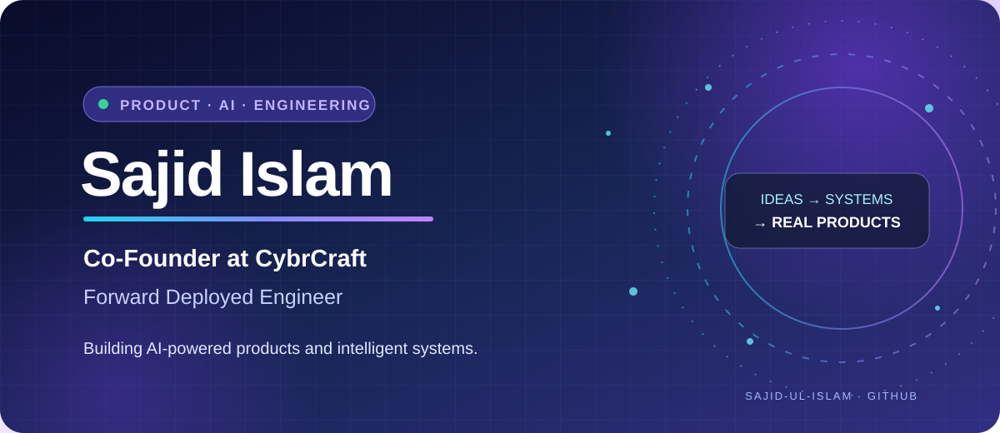

  

  # Sajid Islam

  **Co-Founder at [CybrCraft](https://cybrcraft.com/) · Forward Deployed Engineer · Product & Data**

  Building AI-powered products, practical automations, and data-informed software.

  [Portfolio](https://sajid-ul-islam.vercel.app/) ·
  [LinkedIn](https://www.linkedin.com/in/sajidislamchowdhury/) ·
  [Email](mailto:sajid.islam.chowdhury@gmail.com)

---

## About

I work across product thinking, software engineering, and analytics. I enjoy turning ambiguous business problems into useful software, reliable workflows, and clear insights.

- **Current work:** AI-driven applications, full-stack systems, and operational automation at CybrCraft.
- **Interests:** Agentic AI, product engineering, data systems, and workflow design.
- **Approach:** Start with the problem, build the smallest useful solution, and improve it with evidence.

## Current focus

| Area | What I'm exploring | Tools |
| --- | --- | --- |
| AI engineering | LLM applications, agent workflows, and tool orchestration | Python, LangGraph, LangChain |
| Web & mobile | Product interfaces and cross-platform applications | TypeScript, React, Next.js, React Native, Expo |
| Automation | Reliable workflows for business and operations | n8n, Selenium, APIs |
| Data & analytics | Data preparation, reporting, and decision support | Python, Pandas, NumPy, Plotly |

## Selected work

| Project | What it does | Stack |
| --- | --- | --- |
| [Interactive Portfolio](https://github.com/Sajid-ul-Islam/Portfolio-nextjs) · [Live site](https://sajid-ul-islam.vercel.app/) | Developer portfolio with a browser-based VS Code-inspired experience. | Next.js, React, TypeScript |
| [Cross E-Commerce Apps](https://github.com/Sajid-ul-Islam/Cross_Ecom_Apps) | Cross-platform mobile shopping application architecture. | React Native, Expo, TypeScript |
| [DEEN-OPS](https://github.com/Sajid-ul-Islam/DEEN-OPS) | Order and delivery workflow automation. | Python, Selenium, APIs |
| [Ecom Vision Dashboard](https://e-com-dashborad.vercel.app/) | E-commerce dashboard for revenue, orders, customers, and performance trends. | React, Vite, Tailwind CSS |
| [Thriving Skills](https://github.com/Sajid-ul-Islam/thrivingskill.app) · [Website](https://thrivingskill.com/) | Cross-platform learning product with AI-assisted career features. | React Native, Expo, Gemini API |

## Technologies

**Languages:** Python · JavaScript · TypeScript · SQL · R

**Frontend & mobile:** React · Next.js · React Native · Expo · Tailwind CSS · Vite

**Backend & infrastructure:** Node.js · FastAPI · Fastify · Flask · Docker · GitHub Actions · Vercel

**AI & data:** LangChain · TensorFlow · scikit-learn · Pandas · NumPy · MLflow · Streamlit · Plotly

**Automation:** n8n · Selenium · REST APIs · WordPress

## GitHub activity

  
  

## Find me online

- **Website:** [sajid-ul-islam.vercel.app](https://sajid-ul-islam.vercel.app/)
- **LinkedIn:** [linkedin.com/in/sajidislamchowdhury](https://www.linkedin.com/in/sajidislamchowdhury/)
- **Hugging Face:** [Sajid-ul-Islam](https://huggingface.co/Sajid-ul-Islam)
- **Streamlit:** [@saajiidi](https://streamlit.io/@saajiidi)
- **Email:** [sajid.islam.chowdhury@gmail.com](mailto:sajid.islam.chowdhury@gmail.com)

---

  Thanks for stopping by. Explore the repositories and feel free to connect.
   
  <!-- LAST_UPDATED --> Last refreshed automatically.

